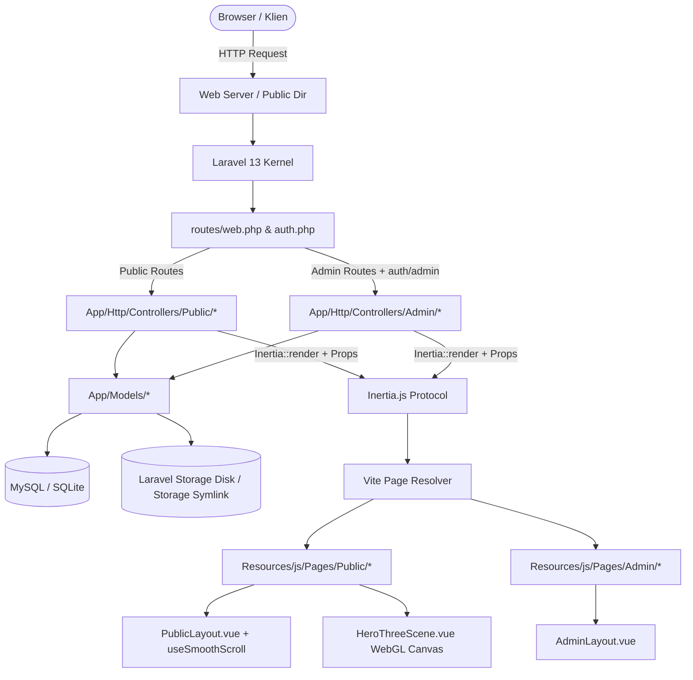

# ARCHITECTURE.md — Arsitektur Sistem dan Alur Data
# Baruna Dwi Cahya Personal Portfolio & CMS

## 1. Ikhtisar Arsitektur

Aplikasi dibangun menggunakan pola arsitektur **Modern Monolithic** dengan **Laravel 13** sebagai server application, **Vue 3** sebagai UI layer, dan **Inertia.js 2.0** sebagai jembatan integrasi protokol tanpa API serializer overhead.

---

## 2. Siklus Request & Data Flow

### A. Alur Halaman Publik
1. **Request Inisial**: Browser memuat URL publik (misal `/projects`).
2. **Middleware**:
   - `HandleInertiaRequests`: Menyuntikkan global shared props (`auth.user`, `flash.success`, `flash.error`).
   - `AddLinkHeadersForPreloadedAssets`: Menambahkan link header untuk optimasi preloading asset.
3. **Controller Execution**:
   - `PublicProjectController@index`: Mengambil data proyek yang berstatus `published` menggunakan Eloquent scope `Project::published()`, melakukan pagination, dan memuat relasi skill (`skills:id,name,slug`).
   - Mengambil navigasi header dan footer dari `NavigationLink::visible()`.
4. **Inertia Response**: Me-render komponen Vue `Public/Projects/Index` dengan props ter-serialize.
5. **Vue Mounting**:
   - Halaman dibungkus dalam `PublicLayout.vue`.
   - `useSmoothScroll` menginisialisasi Lenis dan menyelaraskannya dengan GSAP ticker.

### B. Alur Mutasi Admin & CMS
1. **Request Mutasi**: Admin mengirim form (misal `POST /admin/projects`).
2. **Security Gate**:
   - Middleware `auth` memastikan session user valid.
   - Middleware `admin` (`App\Http\Middleware\EnsureAdmin`) memeriksa flag `user.is_admin === true`. Jika gagal, melempar HTTP 403.
3. **Validasi & Database Transaction**:
   - Request divalidasi ketat (panjang string, uniqueness slug, rule URL).
   - Operasi dibungkus dalam `DB::transaction(...)` untuk menjamin konsistensi multi-tabel (tabel `projects`, pivot `project_skill`, dan tabel `project_images`).
   - File upload (cover atau gallery) disimpan melalui `Storage::disk('public')`.
4. **Audit Logging**:
   - Sistem memanggil `ActivityLog::record(...)` untuk mencatat aksi, entitas ID, dan deskripsi ringkas tanpa menyimpan rahasia/token.
5. **Inertia Redirect**: Mengembalikan `RedirectResponse` dengan flash session `success`. Inertia otomatis mengarahkan UI dan memperbarui cache client.

---

## 3. Integrasi Konten CMS ke Halaman Publik

Semua elemen publik bersifat dinamis dan dikendalikan oleh database:

| Komponen Publik | Sumber Data Backend | Model Terkait | Controller Admin Pengelola |
|---|---|---|---|
| **Branding & Identitas** | Tabel `site_settings` (group `identity`) | `SiteSetting` | `Admin\SiteSettingController` |
| **Hero Headline & Deskripsi** | Tabel `site_settings` (group `home`) | `SiteSetting` | `Admin\HomeContentController` |
| **Hero 3D Scene** | Parameter animasi diatur komponen Vue | Vue Component | `HeroThreeScene.vue` |
| **Featured Projects** | `Project::published()->featured()` | `Project` | `Admin\ProjectController` |
| **Grid Semua Proyek** | `Project::published()` + filter search/category | `Project`, `Skill` | `Admin\ProjectController` |
| **Studi Kasus Proyek** | Field terstruktur: `problem`, `solution`, `features`, dll. | `Project`, `ProjectImage` | `Admin\ProjectController` |
| **Kelompok & Daftar Skill** | `SkillGroup::with('visibleSkills')` | `SkillGroup`, `Skill` | `Admin\SkillGroupController`, `SkillController` |
| **Pendidikan & Karir** | `Education` & `Experience` terurut | `Education`, `Experience` | `Admin\EducationController`, `ExperienceController` |
| **Sertifikasi Terverifikasi** | `Certificate::where('is_visible', true)` | `Certificate` | `Admin\CertificateController` |
| **Menu Navigasi & Sosial** | `NavigationLink` & `SocialLink` | `NavigationLink`, `SocialLink` | `Admin\NavigationController`, `SocialLinkController` |
| **Unduh CV Aktif** | File PDF pada `storage/documents` | `SiteSetting` (`cv_path`) | `Admin\ProfileContentController` |

---

## 4. Sistem Upload & Manajemen File

1. **Storage Disk**: Seluruh aset publik (cover proyek, galeri screenshot proyek, sertifikat, dokumen CV) disimpan pada disk `public` (`storage/app/public`).
2. **Akses Publik**: Tersedia melalui symlink `public/storage` (`php artisan storage:link`).
3. **Pemberian Nama & Lokasi File**:
   - Proyek Cover: `projects/covers/<hash>.<ext>`
   - Proyek Galeri: `projects/gallery/<hash>.<ext>`
   - Dokumen CV: `documents/<hash>.pdf`
   - Sertifikat: `certificates/<hash>.<ext>`
4. **Pencegahan File Yatim (Orphaned Files)**:
   - Saat CV diganti, file lama dihapus via `Storage::disk('public')->delete($oldCv)`.
   - Saat cover proyek diupdate, file cover lama langsung dihapus.
   - Endpoint khusus `DELETE /admin/projects/{project}/images/{image}` menghapus file fisik sekaligus record database.

---

## 5. Arsitektur Interaktivitas (Three.js & Lenis)

### A. Three.js WebGL Engine (`HeroThreeScene.vue`)
- **Letak**: Hanya dirender pada hero section `Home.vue`.
- **Elemen 3D**: Primary Tilted Torus (`#818CF8`), Secondary Orbital Ring (`#C7D2FE`), Wireframe Icosahedron Core, dan Orbital Node Points.
- **Optimasi Daya & Kinerja**:
  - `powerPreference: 'low-power'`.
  - Frame loop otomatis dijeda jika tab tidak aktif (`document.hidden`) atau elemen di luar viewport (`IntersectionObserver`).
  - Responsif terhadap perubahan ukuran wadah (`ResizeObserver`).
  - Mendukung `prefers-reduced-motion`: Jika aktif, animasi perputaran dinonaktifkan dan hanya dirender 1 frame statis.
- **Pembersihan Memori (Lifecycle Management)**:
  - Pada `onBeforeUnmount()`, seluruh geometry dan material di-`dispose()`.
  - Observers di-`disconnect()`.
  - WebGL renderer di-`dispose()` dan canvas elemen dicabut dari DOM.

### B. Smooth Scrolling Engine (`useSmoothScroll.ts`)
- **Implementasi**: Singleton Lenis instance yang dibagikan antarlayout.
- **GSAP Sync**: `lenis.on('scroll', ScrollTrigger.update)` disinkronkan ke `gsap.ticker.add(tickerCallback)`.
- **Inertia Compatibility**: Mendengarkan event `router.on('finish')` untuk me-refresh kalkulasi offset posisi ScrollTrigger setelah navigasi halaman Inertia selesai (`ScrollTrigger.refresh()`).
