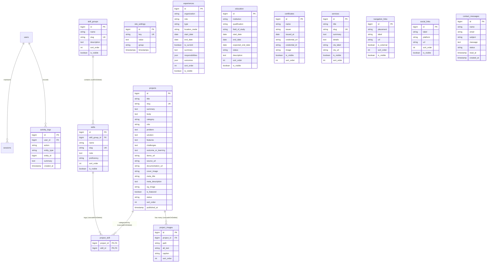

# DATABASE.md — Skema Database, ERD, dan Model Data
# Baruna Dwi Cahya Personal Portfolio & CMS

## 1. Entity Relationship Diagram (ERD)

---

## 2. Rincian Tabel dan Kolom Berdasarkan Migrasi Aktual

### A. Tabel Autentikasi & Pengguna
1. **`users`**
   - `id`: `BIGINT UNSIGNED AUTO_INCREMENT PRIMARY KEY`
   - `name`: `VARCHAR(255)`
   - `email`: `VARCHAR(255) UNIQUE`
   - `email_verified_at`: `TIMESTAMP NULLABLE`
   - `password`: `VARCHAR(255)`
   - `is_admin`: `BOOLEAN DEFAULT false INDEX`
   - `remember_token`: `VARCHAR(100) NULLABLE`
   - `created_at`, `updated_at`: `TIMESTAMP`

2. **`password_reset_tokens`**
   - `email`: `VARCHAR(255) PRIMARY KEY`
   - `token`: `VARCHAR(255)`
   - `created_at`: `TIMESTAMP NULLABLE`

3. **`sessions`**
   - `id`: `VARCHAR(255) PRIMARY KEY`
   - `user_id`: `BIGINT UNSIGNED NULLABLE INDEX`
   - `ip_address`: `VARCHAR(45) NULLABLE`
   - `user_agent`: `TEXT NULLABLE`
   - `payload`: `LONGTEXT`
   - `last_activity`: `INTEGER INDEX`

---

### B. Tabel Konfigurasi & CMS Konten
4. **`site_settings`**
   - `id`: `BIGINT UNSIGNED AUTO_INCREMENT PRIMARY KEY`
   - `key`: `VARCHAR(255) UNIQUE`
   - `value`: `TEXT NULLABLE`
   - `group`: `VARCHAR(255) DEFAULT 'general' INDEX` (grup: `identity`, `home`, `about`, `contact`, `footer`, `seo`)
   - `created_at`, `updated_at`: `TIMESTAMP`
   - *Model Helper*: `SiteSetting::get(key, default)` dan `SiteSetting::set(key, value, group)`.

5. **`skill_groups`**
   - `id`: `BIGINT UNSIGNED AUTO_INCREMENT PRIMARY KEY`
   - `name`: `VARCHAR(255)`
   - `slug`: `VARCHAR(255) UNIQUE`
   - `description`: `TEXT NULLABLE`
   - `sort_order`: `INTEGER DEFAULT 0 INDEX`
   - `is_visible`: `BOOLEAN DEFAULT true INDEX`
   - `created_at`, `updated_at`: `TIMESTAMP`

6. **`skills`**
   - `id`: `BIGINT UNSIGNED AUTO_INCREMENT PRIMARY KEY`
   - `skill_group_id`: `BIGINT UNSIGNED NULLABLE FOREIGN KEY REFERENCES skill_groups(id) ON DELETE SET NULL`
   - `name`: `VARCHAR(255)`
   - `slug`: `VARCHAR(255) UNIQUE`
   - `note`: `TEXT NULLABLE`
   - `proficiency`: `VARCHAR(255) NULLABLE`
   - `sort_order`: `INTEGER DEFAULT 0 INDEX`
   - `is_visible`: `BOOLEAN DEFAULT true INDEX`
   - `created_at`, `updated_at`: `TIMESTAMP`

7. **`projects`**
   - `id`: `BIGINT UNSIGNED AUTO_INCREMENT PRIMARY KEY`
   - `title`: `VARCHAR(255)`
   - `slug`: `VARCHAR(255) UNIQUE`
   - `summary`: `TEXT NULLABLE`
   - `body`: `TEXT NULLABLE`
   - `category`: `VARCHAR(255) NULLABLE INDEX`
   - `role`: `VARCHAR(255) NULLABLE`
   - `problem`: `TEXT NULLABLE`
   - `solution`: `TEXT NULLABLE`
   - `features`: `TEXT NULLABLE`
   - `challenges`: `TEXT NULLABLE`
   - `outcome_or_learning`: `TEXT NULLABLE`
   - `demo_url`: `VARCHAR(255) NULLABLE`
   - `source_url`: `VARCHAR(255) NULLABLE`
   - `documentation_url`: `VARCHAR(255) NULLABLE`
   - `cover_image`: `VARCHAR(255) NULLABLE`
   - `meta_title`: `VARCHAR(255) NULLABLE`
   - `meta_description`: `TEXT NULLABLE`
   - `og_image`: `VARCHAR(255) NULLABLE`
   - `is_featured`: `BOOLEAN DEFAULT false INDEX`
   - `status`: `VARCHAR(255) DEFAULT 'draft' INDEX` (`draft`, `published`, `archived`)
   - `sort_order`: `INTEGER DEFAULT 0 INDEX`
   - `published_at`: `TIMESTAMP NULLABLE`
   - `created_at`, `updated_at`: `TIMESTAMP`
   - *Scopes*: `published()`, `featured()`.

8. **`project_images`**
   - `id`: `BIGINT UNSIGNED AUTO_INCREMENT PRIMARY KEY`
   - `project_id`: `BIGINT UNSIGNED FOREIGN KEY REFERENCES projects(id) ON DELETE CASCADE`
   - `path`: `VARCHAR(255)`
   - `alt_text`: `VARCHAR(255) NULLABLE`
   - `caption`: `VARCHAR(255) NULLABLE`
   - `sort_order`: `INTEGER DEFAULT 0`
   - `created_at`, `updated_at`: `TIMESTAMP`

9. **`project_skill` (Pivot Table)**
   - `project_id`: `BIGINT UNSIGNED FOREIGN KEY REFERENCES projects(id) ON DELETE CASCADE`
   - `skill_id`: `BIGINT UNSIGNED FOREIGN KEY REFERENCES skills(id) ON DELETE CASCADE`
   - `PRIMARY KEY (project_id, skill_id)`

10. **`experiences`**
    - `id`: `BIGINT UNSIGNED AUTO_INCREMENT PRIMARY KEY`
    - `organization`: `VARCHAR(255)`
    - `role`: `VARCHAR(255)`
    - `type`: `VARCHAR(255) NULLABLE` (e.g. `Internship`, `Full-time`, `Contract`)
    - `location_mode`: `VARCHAR(255) NULLABLE` (`Onsite`, `Remote`, `Hybrid`)
    - `start_date`: `DATE`
    - `end_date`: `DATE NULLABLE`
    - `is_current`: `BOOLEAN DEFAULT false`
    - `summary`: `TEXT NULLABLE`
    - `responsibilities`: `JSON NULLABLE`
    - `outcomes`: `JSON NULLABLE`
    - `sort_order`: `INTEGER DEFAULT 0 INDEX`
    - `is_visible`: `BOOLEAN DEFAULT true INDEX`
    - `created_at`, `updated_at`: `TIMESTAMP`

11. **`education`**
    - `id`: `BIGINT UNSIGNED AUTO_INCREMENT PRIMARY KEY`
    - `institution`: `VARCHAR(255)`
    - `qualification`: `VARCHAR(255)` (e.g. `Sarjana Komputer (S.Kom)`)
    - `field_of_study`: `VARCHAR(255) NULLABLE` (e.g. `Teknik Informatika`)
    - `start_date`: `DATE`
    - `end_date`: `DATE NULLABLE`
    - `expected_end_date`: `DATE NULLABLE`
    - `status`: `VARCHAR(255) DEFAULT 'in_progress'`
    - `description`: `TEXT NULLABLE`
    - `sort_order`: `INTEGER DEFAULT 0 INDEX`
    - `is_visible`: `BOOLEAN DEFAULT true INDEX`
    - `created_at`, `updated_at`: `TIMESTAMP`

12. **`certificates`**
    - `id`: `BIGINT UNSIGNED AUTO_INCREMENT PRIMARY KEY`
    - `name`: `VARCHAR(255)`
    - `issuer`: `VARCHAR(255)`
    - `issued_at`: `DATE NULLABLE`
    - `credential_url`: `VARCHAR(255) NULLABLE`
    - `credential_id`: `VARCHAR(255) NULLABLE`
    - `image`: `VARCHAR(255) NULLABLE`
    - `is_visible`: `BOOLEAN DEFAULT true INDEX`
    - `sort_order`: `INTEGER DEFAULT 0 INDEX`
    - `created_at`, `updated_at`: `TIMESTAMP`

13. **`services` (Opsional)**
    - `id`: `BIGINT UNSIGNED AUTO_INCREMENT PRIMARY KEY`
    - `title`: `VARCHAR(255)`
    - `slug`: `VARCHAR(255) UNIQUE`
    - `summary`: `TEXT NULLABLE`
    - `details`: `TEXT NULLABLE`
    - `cta_label`: `VARCHAR(255) NULLABLE`
    - `cta_url`: `VARCHAR(255) NULLABLE`
    - `is_visible`: `BOOLEAN DEFAULT true INDEX`
    - `sort_order`: `INTEGER DEFAULT 0 INDEX`
    - `created_at`, `updated_at`: `TIMESTAMP`

14. **`navigation_links`**
    - `id`: `BIGINT UNSIGNED AUTO_INCREMENT PRIMARY KEY`
    - `placement`: `VARCHAR(255) DEFAULT 'header' INDEX` (`header`, `footer`)
    - `label`: `VARCHAR(255)`
    - `url`: `VARCHAR(255)`
    - `is_external`: `BOOLEAN DEFAULT false`
    - `sort_order`: `INTEGER DEFAULT 0 INDEX`
    - `is_visible`: `BOOLEAN DEFAULT true INDEX`
    - `created_at`, `updated_at`: `TIMESTAMP`
    - *Scopes*: `header()`, `footer()`, `visible()`.

15. **`social_links`**
    - `id`: `BIGINT UNSIGNED AUTO_INCREMENT PRIMARY KEY`
    - `label`: `VARCHAR(255)`
    - `platform`: `VARCHAR(255)` (`github`, `linkedin`, `instagram`, `whatsapp`, etc.)
    - `url`: `VARCHAR(255)`
    - `sort_order`: `INTEGER DEFAULT 0 INDEX`
    - `is_visible`: `BOOLEAN DEFAULT true INDEX`
    - `created_at`, `updated_at`: `TIMESTAMP`
    - *Scopes*: `visible()`.

16. **`contact_messages`**
    - `id`: `BIGINT UNSIGNED AUTO_INCREMENT PRIMARY KEY`
    - `name`: `VARCHAR(255)`
    - `email`: `VARCHAR(255)`
    - `subject`: `VARCHAR(255) NULLABLE`
    - `message`: `TEXT`
    - `status`: `VARCHAR(255) DEFAULT 'unread' INDEX` (`unread`, `read`, `archived`)
    - `read_at`: `TIMESTAMP NULLABLE`
    - `created_at`: `TIMESTAMP NULLABLE`

17. **`activity_logs`**
    - `id`: `BIGINT UNSIGNED AUTO_INCREMENT PRIMARY KEY`
    - `user_id`: `BIGINT UNSIGNED NULLABLE FOREIGN KEY REFERENCES users(id) ON DELETE SET NULL`
    - `action`: `VARCHAR(255)` (`created`, `updated`, `deleted`, dll.)
    - `entity_type`: `VARCHAR(255) NULLABLE`
    - `entity_id`: `BIGINT UNSIGNED NULLABLE`
    - `summary`: `TEXT NULLABLE`
    - `created_at`: `TIMESTAMP NULLABLE`
    - `INDEX (entity_type, entity_id)`
